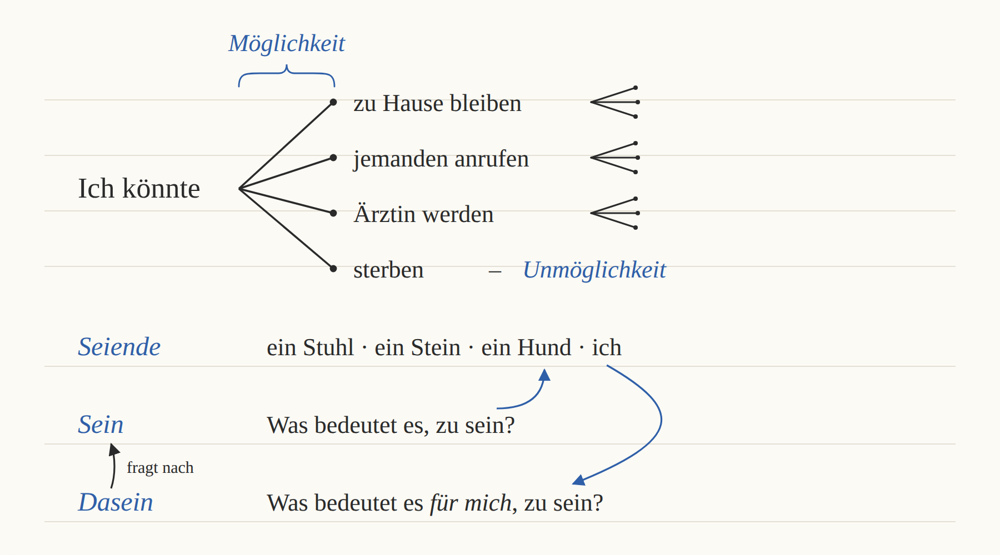

Es ist Herbst, meine Lieblingsjahreszeit. So entspannt am Bullingerplatz. 🍂\
Gute Nacht, schlaf gut.

Ich habe von meiner Mutter (meinem Vater) und meiner Großmutter geträumt. Es war sehr beunruhigend und emotional.

Fähigkeit zum Vergrößern und Verkleinern.

> „Die Möglichkeit der absoluten Unmöglichkeit des Daseins“

Endlich habe ich meine Zahnbürste aufgeladen. In letzter Zeit bin ich nicht besonders motiviert. :(

Die Umkehrung der Entropie braucht zu viel Energie.

> „Charakterschwächen sind die Spuren des Überlebens, die Menschen im Umgang mit der Welt nach außen tragen.“

Geh schlafen, es ist schon 1:49 Uhr. Soll ich Joghurt aus dem Kühlschrank holen? Nee.

Mein Leben gehört mir, mein Tod gehört mir.

„Wo hast du das her?“ „Da drüben.“

Wann ist mir klar geworden, dass ich sterben werde? Daran kann ich mich überhaupt nicht erinnern.

Heute bin ich vor meinen Kollegen gestolpert und hingefallen und habe mit einer neuen Freundin im Kino einen Film geschaut. Morgen ist Mittherbstfest, und wir machen eine Hausparty.   🌕 ← *der Mond*

Meine lieben Mitbewohner haben mir geholfen, meine Wunde zu verbinden. ♡

### Wörter der Woche

| Deutsch | Englisch |
|---|---|
| die Möglichkeit | possibility |
| die Fähigkeit | ability |
| belastend | stressful, burdensome |
| aufwühlend | emotionally upsetting, stirring |
| von jemandem träumen (von + Dativ) | dream of sb. |
| beunruhigend | distressing, disquieting, worrying, unsettling |
| Für Sie empfohlen | Recommended for you |
| die Bürste | brush |
| aufladen | charge (Ich lade mein Handy auf.) |
| sterben | die |
| gehören | belong to |
| Das Lied, das ich höre | the song that I hear (vs. Ich höre das Lied.) |
| nach außen tragen | express outwardly |
| der Umgang mit etw./jmdm. | way of dealing with, relation to sth. |
| das Überleben, überleben | survival, to survive |
| die Spur | trace, mark, trail (痕迹) |
| die Schwäche | flaw, weakness |
| umkehren | to reverse |
| schauen | watch |
| hinfallen | fall |
| stolpern | trip |
| die Freiheit | freedom |
| überhaupt | at all |
| vor (Ort) + Dativ | in front of |
| verbinden, der Verband | bandage (v.), bandage (n.) |
| daran = da + an | about it, to it (Ich kann mich nicht daran erinnern.) |
| sich erinnern an + Akkusativ | remember sth. |
| klar werden | realize (Mir ist klar geworden, dass …) |
