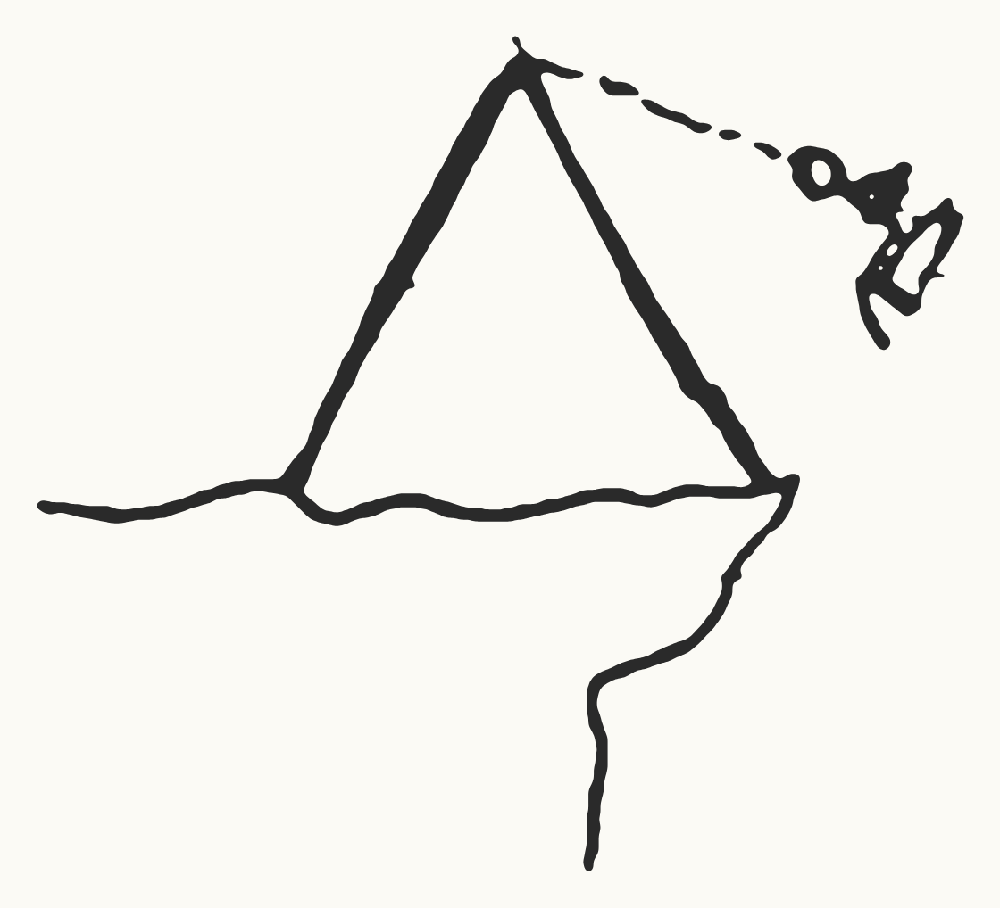

见鬼了，昨天才洗的头，今天就头皮屑漫天飞。晚上回来看心情洗吧，现在戴个头巾遮一下。\
天哪我的字太丑了。（练练吧（下次一定）。）

Zu erledigen: Weniger Junkfood essen. Meinen Kissenbezug waschen. Michel fragen.\
Und endlich wieder im Gym gewesen. Mein Rücken und meine Oberschenkelinnenseiten tun weh.\
Es wird trockener. Trink mehr Wasser.

Was für eine friedliche Nacht. Bäume gefallen mir.

~~~\
10.11.2026 Dreams
1. (longest) \
Went for a swim in the lake in this weather. Somewhat crowded deck. It was quite warm. Went to somewhere else with a group, then went to someone’s WG. Very cute, tastefully decorated small garden (w some toys?). Cozy interior. I have been here once before. Lied on the bed with my friend and fell asleep.
2. (nightmare) \
(Was happy yesterday but) am depressed again today. \
Symbol: ▼
3. (shortest) \
I got off the bus, transformed into a lion, kicked a racist little lion across the valley. (And told his parents.)

3.5. \
I’m on a big swing at a cliff.

~~~

Kann kaum laufen. Die Folgen davon, dass ich das Gym geschwänzt habe.

Was Marc gesagt hat, war verrückt. Ich werde Lucy fragen.

Ich schreibe in letzter Zeit ziemlich viel. Teilweise inspiriert von Annie Ernaux’ „Sich verlieren“.

Mein Jetlag …

Letzte Nacht habe ich von meinen Eltern geträumt. Es gab immer noch eine gewisse Spannung, aber zumindest war nichts davon grausam oder aufwühlend.

Die Bedeutung der Website für mich:
- ein klareres Bild davon, wer ich bin: meine Vergangenheit und mein gegenwärtiges Leben. (Erkenne dich selbst. Know thyself.)
- Motivation, weiterzumachen.

Alles dreht sich um Balance. \
Es ist so schwer, ein Gleichgewicht zu finden.

### Wörter der Woche

| Deutsch | Englisch |
|---|---|
| ist gewesen | has been (past participle of sein) |
| friedlich | serene, peaceful |
| der Kissenbezug | pillowcase |
| *Alles* ist eine Frage der *Balance.* | … is a matter of … |
| sich um etw. drehen | to revolve around sth. |
| das Gleichgewicht    (*✓ here)* | balance (equilibrium, stability) |
| die Ausgewogenheit | balance (well-proportioned-ness) |
| weitermachen | to continue, proceed, carry on, keep going |
| erkennen | recognize |
| gegenwärtig | present, current |
| die Vergangenheit | past |
| die Bedeutung (von etw. für jmdn.) | meaning |
| grausam | gruesome, cruel, horrible |
| zumindest | at least |
| die Spannung | tension |
| gewiss | sure, certain |
| sich verlieren | to lose oneself |
| teilweise | partly, partially |
| schwänzen | to skip (school, classes) |
| die Folge
(Folgen davon, dass …) | consequence
(consequences of …) |
| kaum | barely, hardly |
