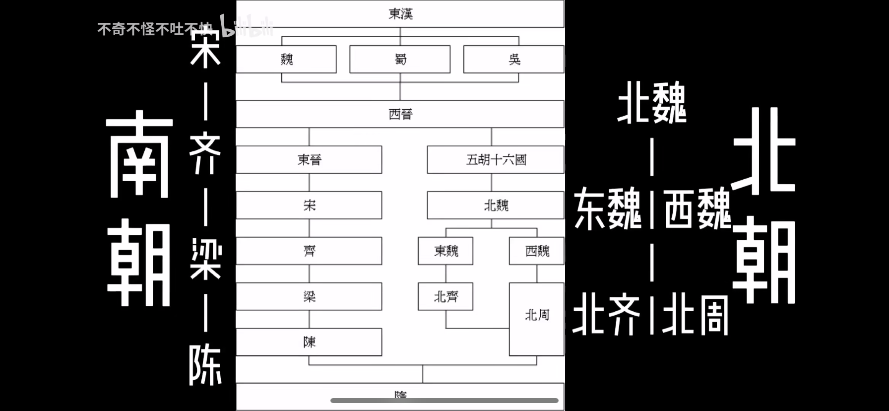
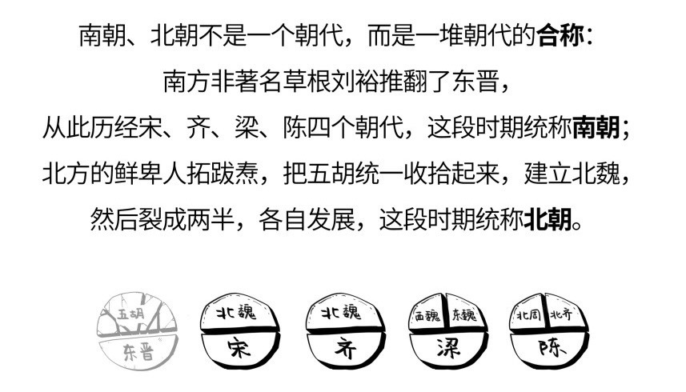

### 电视剧朝代顺序

#### 东晋十六国
1. 《孤芳不自赏》东晋 孝武帝司马曜（在位372年-396年）

#### 南北朝（北魏统一时期）
1. 《锦绣南歌》南朝宋 文帝刘义隆（在位424年-453年）
2. 《锦绣未央》北魏 太武帝拓跋焘（在位424年-452年）至 文成帝拓跋浚（在位452-465年）
3. 《凤求凰》南朝宋 前废帝刘子业（在位464年-465年）至 后废帝刘昱（在位472年-477年）；北魏 献文帝拓跋弘（在位466-471年）至 孝文帝拓跋宏（在位471-499年）

#### 南北朝（北魏分裂时期）
1. 《琅琊榜》南朝梁 武帝萧衍（在位502年-549年）
2. 《楚乔传》北朝西魏 文帝元宝炬（在位534年-551年）至 恭帝拓跋廓（在位554年-556年）
3. 《醉玲珑》北朝西魏 废帝元钦（在位551年-554年）至 恭帝拓跋廓（在位554年-556年）
4. 《陆贞传奇》北齐 文宣帝高洋（在位550年-559年）至 后主高纬（在位565年-577年）
5. 《兰陵王》北齐 孝昭帝高演（在位560年-561年）至 后主高纬（在位565年-577年）
6. 《兰陵王妃》北周 明帝宇文毓（在位557年-560年）至 武帝宇文邕（在位560年-578年）
7. 《独孤皇后》北周 明帝宇文毓（在位557年-560年）至 隋文帝杨坚（在位557年-581年）
8. 《独孤天下》北周 孝闵帝宇文觉（在位557年）至 隋文帝杨坚（在位557年-581年）

### 南朝（东晋灭）

#### 宋

| 君主 | 谥号 |
|---|---|
| 刘裕 | 武帝 |
| 刘义符 | 少帝 |
| 刘义隆 | 文帝 |
| 刘劭 | 太子元帝 |
| 刘骏 | 孝武帝 |
| 刘子业 | 前废帝 |
| 刘彧 | 明帝 |
| 刘昱 | 后废帝 |
| 刘準 | 顺帝 |

#### 齐

| 君主 | 谥号 |
|---|---|
| 萧道成 | 高帝 |
| 萧赜 | 武帝 |
| 萧昭业 | 郁林王 |
| 萧昭文 | 海陵王 |
| 萧鸾 | 明帝 |
| 萧宝卷 | 东昏侯 |
| 萧宝融 | 和帝 |

#### 梁

| 君主 | 谥号 |
|---|---|
| 萧衍 | 武帝 |
| 萧纲 | 简文帝 |
| ... |  |
| 萧纪 | 武陵王 |
| 萧绎 | 孝元帝 |
| 侯景 |  |
| 萧渊明 | 闵帝 |
| 萧方智 | 敬帝 |

#### 陈

| 君主 | 谥号 |
|---|---|
| 陈霸先 | 武帝 |
| 陈蒨 | 文帝 |
| 陈伯宗 | 临海王 |
| 陈顼 | 孝宣帝 |
| 陈叔宝 | 长城炀公 |

### 北朝（五胡十六国灭）

#### 北魏

| 君主 | 庙号 / 谥号 |
|---|---|
| 拓跋珪 | 太祖道武帝 |
| 拓跋嗣 | 太宗明元帝 |
| 拓跋焘 | 世祖太武帝 |
| 拓跋余 | 南安隐王 |
| 拓跋濬 | 高宗文成帝 |
| 拓跋弘 | 显祖献文帝 |
| 拓跋宏 | 高祖孝文帝 |
| 元恪 | 世宗玄武帝 |
| 元诩 | 肃宗孝明帝 |
| 元子攸 | 敬宗孝庄帝 |
| 元晔 | 长广王 |
| 元恭 | 前废帝 |
| 元朗 | 后废帝 |
| 元修 | 显宗 |

#### 东魏

| 君主 | 庙号 / 谥号 |
|---|---|
| 高欢 | 权臣 |
| 元善见 | 孝静帝 |

#### 西魏

| 君主 | 庙号 / 谥号 |
|---|---|
| 宇文泰 | 实权 |
| 元宝炬 | 文昭帝 |
| 元钦 | 废帝 |
| 元廓 | 恭帝 |

#### 北齐

| 君主 | 庙号 / 谥号 |
|---|---|
| 高欢 | 高祖献武帝 |
| 高洋 | 显祖文宣帝 |
| 高殷 | 废帝 |
| 高演 | 肃宗孝昭帝 |
| 高湛 | 世祖武成帝 |
| 高纬 | 后主 |
| 高恒 | 幼主 |
| 高绍义 | 末帝 |

#### 北周

| 君主 | 庙号 / 谥号 |
|---|---|
| 宇文泰 | 文帝 |
| 宇文护 | 实权 |
| 宇文觉 | 周公 孝闵帝 |
| 宇文毓 | 明帝 |
| 宇文邕 | 武帝 |
| 宇文赟 | 宣帝 |
| 宇文阐 | 静帝 |

### 隋

| 君主 | 谥号 |
|---|---|
| 杨坚 | 文帝 |
| 杨广 | 炀帝 |
| 杨侑 | 恭帝 |
| 杨侗 | 燕王 |
