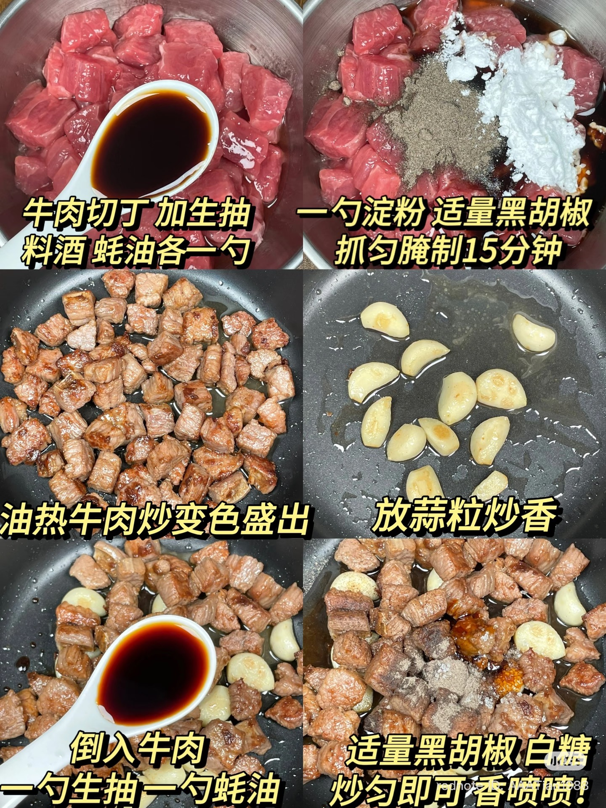

先放蒜再放洋葱，中小火

**最推荐的 herb**

**1. Thyme（百里香）**
- 香气温和、略带木质和草本气息，跟牛肉、蒜非常搭。适合煎炒牛肉。
- 用量：250g 牛肉放 ¼–½ tsp 干 thyme。

**2. Rosemary（迷迭香）**
- 香气浓烈，带松木和清凉感。非常适合蒜香牛肉，但容易盖过蒜味。
- 用量：250g 牛肉放一小撮切碎的干 rosemary。

**3. Oregano（牛至）**
- 带一点辛香、微苦，适合偏地中海风味的蒜炒牛肉。
- 用量：¼ tsp。

**4. Parsley（欧芹）**
- 清新、温和，不会抢味。特别适合最后撒上去。
- 用量：一小把切碎，出锅后加入。

**5. Basil（罗勒）**
- 甜香、清新，适合搭配蒜、黑胡椒和一点辣椒。
- 用量：少量，建议新鲜罗勒最后加入。
- 蒜 + Thyme + 黑胡椒 + 少量 Rosemary：浓郁的西式蒜香牛肉。
- 蒜 + Oregano + 黑胡椒 + Chili flakes：偏地中海风味。
- 蒜 + Parsley + 黄油：简单经典的蒜香牛肉。

一个小技巧： 干燥 herb 可以在牛肉快炒熟时加入，避免高温久炒导致香气挥发甚至发苦。新鲜 parsley、basil 则最好出锅前加入。

如果你想保留中式炒牛肉的鲜香，我最推荐 Thyme + 黑胡椒，不要放太多 herb。
