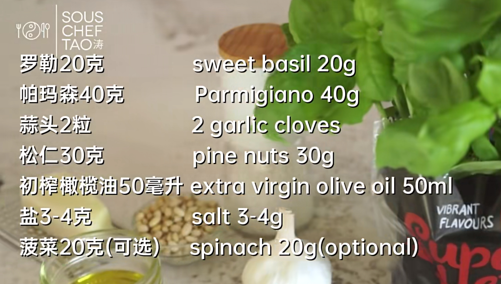

## Ingredients
- herbs - 一大把
  - basil
  - arugula
  - (parsely)
  - (sage)
- pine nuts (roasted) - 10g
  - or pan fry low heat 1 min
- olive oil
- parmigiano reggiano - 3 tbsp=30g
- (pepper)
- salt
- (garlic - 1 clove)

## Procedure
1. Herbs 热水烫 3-5s, cool in fridge / ice water
2. Gently dry w paper towels
3. (Blend: garlic and 3 tbsp olive oil → pine nuts → herbs, cheese, pinch of salt, 2 tbsp oil, 30s)
4. (scrape down cheese on wall, mix manually, taste)
5. Blend: cheese into flakes → pine nuts, herbs, olive oil, pepper, salt

(Keep in fridge for max 2 weeks)

